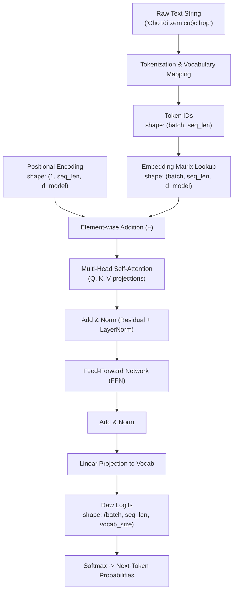
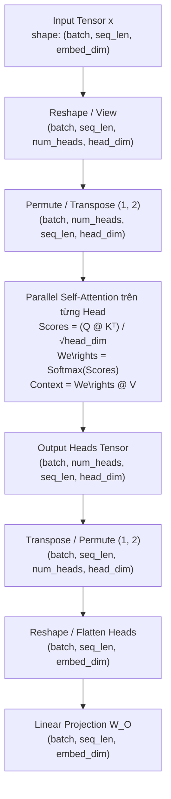

# Nền Tảng Kiến Trúc Transformer (Transformer Foundation)

Tài liệu này tổng hợp toàn bộ lý thuyết nền tảng, cơ chế tính toán tensor và trực giác hình học của kiến trúc **Transformer**. Nội dung được biên soạn làm cầu nối kỹ thuật giữa các mô hình học sâu truyền thống (Month 02) và kỹ thuật ứng dụng mô hình ngôn ngữ lớn (LLM Engineering - Month 03) trong dự án `ai-assistant-platform`.

---

## 1. Bức Tranh Tổng Thể & Động Lực Phát Triển

### 1.1. Hạn chế của các phương pháp trước Transformer
Trong Tuần 1 đến Tuần 3, hệ thống đã thử nghiệm hai cách tiếp cận:
1. **Đặc trưng thủ công (Hand-crafted Features - Scikit-learn Baseline)**:
   - Dùng độ dài câu (`text_length`), số từ (`word_count`), cờ chứa dấu `?`.
   - **Hạn chế**: Bỏ qua hoàn toàn trật tự từ và ngữ nghĩa từ vựng. Hai câu khác hẳn ý định như *"Lên lịch họp"* và *"Soạn email gấp"* có thể có vector đặc trưng y hệt nhau.
2. **Mạng nơ-ron truyền thống (MLP / RNN / LSTM)**:
   - **MLP**: Phẳng hóa hoặc gom trung bình từ làm mất ngữ cảnh chuỗi (loss of sequence order).
   - **RNN / LSTM**: Xử lý tuần tự từ trái qua phải từng token một. Quá trình này không thể tính toán song song (parallelization bottleneck) và dễ gặp hiện tượng suy hao thông tin khi câu quá dài (vanishing context over long range).

### 1.2. Đột phá của Transformer
Kiến trúc Transformer (Vaswani et al., 2017) giải quyết triệt để hai bài toán trên nhờ:
- **Cơ chế Tự chú ý (Self-Attention)**: Cho phép mọi từ trong câu tương tác trực tiếp với nhau theo thời gian hằng số O(1) về khoảng cách thông tin.
- **Tính toán song song hoàn toàn (Full Parallelization)**: Không cần vòng lặp qua từng bước thời gian như RNN, toàn bộ câu được xử lý đồng thời dưới dạng các ma trận tensor trên GPU.



---

## 2. Tokenization, Vocabulary & Attention Mask

Giai đoạn đầu tiên của mọi hệ thống Transformer là chuyển đổi văn bản dạng chuỗi ký tự tự nhiên thành các số nguyên (Token IDs) mà mô hình số học có thể xử lý.

Chi tiết cài đặt minh họa tại script: [tokenization_overview.py](../scripts/tokenization_overview.py).

### 2.1. Phân biệt các khái niệm cốt lõi
- **Raw Text**: Chuỗi ký tự thô do người dùng nhập (ví dụ: `"Tôi muốn biết lịch trình hôm nay"`).
- **Token**: Đơn vị ngôn ngữ nhỏ nhất sau khi cắt chuỗi (có thể là từ, từ con - subword, hoặc ký tự).
- **Vocabulary (Từ vựng)**: Bảng tra cứu ánh xạ hai chiều giữa token (chuỗi) và số nguyên duy nhất (Token ID).
- **Special Tokens**:
  - `<pad>` (thường có ID = `0`): Dùng để bù độ dài cho các câu ngắn hơn trong cùng một batch.
  - `<unk>` (thường có ID = `1`): Đại diện cho các từ chưa từng xuất hiện trong từ vựng (Out-of-Vocabulary - OOV).

### 2.2. Vai trò sống còn của Attention Mask
Khi nhóm các câu có độ dài khác nhau vào chung một tensor 2D `(batch_size, max_seq_length)`, các vị trí thiếu sẽ được điền bằng `pad_id = 0`.

Tuy nhiên, `<pad>` chỉ là một giá trị lấp chỗ trống kỹ thuật số, **không mang thông tin ngữ nghĩa**. Nếu đưa trực tiếp vào phép toán Self-Attention, mô hình sẽ bị phân tán sự chú ý vào các token vô nghĩa này.

Do đó, hệ thống cần tạo một ma trận nhị phân **Attention Mask**:
- Giá trị `1`: Token thực tế cần được tính toán sự chú ý.
- Giá trị `0`: Vị trí padding cần bị vô hiệu hóa (triệt tiêu trọng số attention về `0` qua phép gán `-inf` trước khi vào Softmax).

```text
Sequence A (9 tokens): [3, 15, 16, 5, 4, 7, 12, 14, 11] -> Mask: [1, 1, 1, 1, 1, 1, 1, 1, 1]
Sequence B (7 tokens): [15, 9, 2, 8, 13, 6, 10, 0, 0] -> Mask: [1, 1, 1, 1, 1, 1, 1, 0, 0]
                                                   ▲   ▲                    ▲   ▲
                                                Padding Tokens           Mask = 0
```

> [!NOTE]
> Script [tokenization_overview.py](../scripts/tokenization_overview.py) sử dụng phương pháp tách từ theo khoảng trắng (whitespace tokenization) nhằm mục đích giáo khoa. Trong các LLM sản xuất thực tế (GPT-4, LLaMA), các thuật toán subword tinh vi hơn như **Byte-Pair Encoding (BPE)** hoặc **WordPiece** được sử dụng để tránh hiện tượng bùng nổ kích thước từ vựng và xử lý linh hoạt mọi từ ghép, tiền tố, hậu tố.

---

## 3. Embedding Lookup & Kích Thước Tensor (Tensor Shapes)

Token ID chỉ là các chỉ số định danh rời rạc (categorical integers). Một số nguyên lớn hơn không có nghĩa là từ đó có giá trị lớn hơn hay quan trọng hơn.

Script minh họa của project: [embedding_overview.py](../scripts/embedding_overview.py).

### 3.1. Bảng Embedding (`torch.nn.Embedding`)

Để đưa vào mạng nơ-ron, mỗi token ID được ánh xạ thành một vector thực nhiều chiều (dense vector) thông qua bảng embedding:

- Bảng embedding thực chất là ma trận trọng số có kích thước `W_embed ∈ ℝ^(vocab_size × embedding_dim)`.
- Khi truyền vào một token ID `k`, thao tác lookup tương đương với việc lấy ra dòng thứ `k` của ma trận: `v = W_embed[k, :]`.
- Cùng một token ID sẽ lấy cùng một dòng trong bảng embedding, miễn là đang dùng cùng một embedding layer và trọng số chưa bị cập nhật.
- Các vector là tham số có thể huấn luyện (learnable parameters). Khi optimizer cập nhật `embedding.we\right`, biểu diễn của token cũng thay đổi.

Trong demo hiện tại, embedding layer được tạo như sau:

```python
embedding = nn.Embedding(
    num_embeddings=len(vocabulary),
    embedding_dim=4,
    padding_idx=vocabulary["<pad>"],
)
embedded = embedding(tensor_vocab_pad_batch)
```

Ý nghĩa các tham số:

- `num_embeddings=28`: vocabulary có 28 token, gồm cả `<pad>` và `<unk>`.
- `embedding_dim=4`: mỗi token ID được biểu diễn bằng một vector gồm 4 số thực.
- `padding_idx=0`: vector của `<pad>` không được cập nhật khi training và trong demo được trả về dưới dạng `[0, 0, 0, 0]`.

> [!IMPORTANT]
> Các giá trị embedding trong demo được khởi tạo ngẫu nhiên và model chưa được train. Vì vậy, chúng chỉ minh họa thao tác lookup và tensor shape, chưa thể hiện ý nghĩa ngữ nghĩa của từ.

### 3.2. Biến đổi kích thước Tensor (Shape Transformation)

Ba câu mẫu sau khi padding tạo thành tensor token ID có shape `(3, 11)`:

- `batch_size = 3`: có ba câu.
- `sequence_length = 11`: câu dài nhất có 11 token; hai câu ngắn hơn được thêm `<pad>`.
- Kiểu dữ liệu của token ID là `torch.int64`, cũng chính là `torch.long` mà `nn.Embedding` yêu cầu.

Kết quả chạy script:

| Thành phần | Shape | Ý nghĩa |
| --- | --- | --- |
| Token IDs | `(3, 11)` | Mỗi vị trí chứa một ID trong vocabulary |
| Embedding we\right | `(28, 4)` | 28 token, mỗi token có vector 4 chiều |
| Embedding output | `(3, 11, 4)` | Mỗi ID trong từng câu được thay bằng vector 4 chiều |

Quy tắc tổng quát:

```text
(batch_size, sequence_length)
             ↓ nn.Embedding
(batch_size, sequence_length, embedding_dim)
```

Embedding lookup giữ nguyên hai chiều `batch_size` và `sequence_length`, sau đó thêm chiều `embedding_dim` ở cuối.

### 3.3. Quan sát từ kết quả demo

- Token `nay` có cùng token ID ở câu thứ nhất và câu thứ ba, nên hai vị trí này nhận cùng một vector embedding trong một lần chạy.
- Những vị trí có token ID `0` là `<pad>` và trả về vector toàn số `0` vì layer sử dụng `padding_idx=0`.
- Giá trị cụ thể của các vector có thể khác ở lần chạy tiếp theo vì script chưa cố định random seed.
- `padding_idx` chỉ xử lý vector của padding trong embedding layer. Khi tính self-attention, model vẫn cần attention mask để ngăn các token thật chú ý vào vị trí padding.

### 3.4. So sánh với đặc trưng thủ công

Classifier trước đó dùng các đặc trưng được định nghĩa sẵn như độ dài câu hoặc số từ. Embedding khác ở chỗ model có thể học trực tiếp vector biểu diễn cho từng token trong quá trình training. Tuy nhiên, embedding lookup đơn lẻ vẫn chưa xét ngữ cảnh: token có cùng ID luôn nhận cùng vector ban đầu. Các tầng self-attention phía sau mới kết hợp thông tin từ những token khác để tạo biểu diễn phụ thuộc ngữ cảnh.

### 3.5. Tự kiểm tra

- Nếu đổi `embedding_dim` từ `4` thành `8`, output phải đổi từ `(3, 11, 4)` thành `(3, 11, 8)`.
- Nếu vocabulary có thêm token mới, chiều đầu tiên của `embedding.we\right` phải tăng theo `len(vocabulary)`.
- Nếu truyền tensor số thực thay vì `torch.long`, `nn.Embedding` sẽ báo lỗi vì input phải chứa các chỉ số nguyên.
- Không được kết luận hai từ gần nghĩa chỉ dựa trên embedding ngẫu nhiên chưa qua training.

---

## 4. Cơ Chế Scaled Dot-Product Attention

Đây là trái tim của kiến trúc Transformer, cho phép từng token trong chuỗi "nhìn" sang các token khác để cập nhật biểu diễn ngữ cảnh cho chính nó.

```mermaid
flowchart LR
    Q["Query (Q)<br/>(seq_len, d_k)"] --> M1["MatMul (Q · Kᵀ)"]
    K["Key (K)<br/>(seq_len, d_k)"] --> M1
    M1 --> S["Scale by 1/√d_k"]
    S --> MS["Optional Masking<br/>(Padding / Causal)"]
    MS --> SM["Softmax (dim=-1)"]
    SM -->|Attention We\rights (seq_len, seq_len)| M2["MatMul (We\rights · V)"]
    V["Value (V)<br/>(seq_len, d_v)"] --> M2
    M2 --> O["Output Context Vectors<br/>(seq_len, d_v)"]
```

Script minh họa của project: [attention_shapes.py](../scripts/attention_shapes.py).

### 4.1. Bộ ba Query (Q), Key (K), Value (V)
Từ vector embedding ban đầu của mỗi token, mô hình chiếu qua ba ma trận trọng số học được để tạo thành 3 vector:
- **Query (Q)**: Vector đại diện cho câu hỏi: *"Tôi là token hiện tại, tôi đang cần tìm kiếm thông tin gì xung quanh?"*
- **Key (K)**: Vector đại diện cho nhãn/chỉ mục: *"Tôi có đặc điểm gì để các token khác tìm đến tôi?"*
- **Value (V)**: Vector đại diện cho nội dung thực: *"Nếu bạn chú ý đến tôi, đây là lượng thông tin tôi sẽ cung cấp cho bạn."*

### 4.2. Công thức toán học & Các bước tính toán

`Attention(Q, K, V) = softmax((Q · Kᵀ) / √d_k) · V`

1. **Tính điểm thô (Raw Attention Scores)**: `Scores = Q · Kᵀ`
   - Thực hiện nhân ma trận giữa Q và K chuyển vị.
   - Kích thước: `(batch, seq_len, d_k) × (batch, d_k, seq_len) -> (batch, seq_len, seq_len)`.
   - Mỗi phần tử `Scores[i, j]` thể hiện độ tương thích giữa token thứ `i` và token thứ `j`.

2. **Chia tỷ lệ (Scaling)**: `Scores_scaled = Scores / √d_k`
   - Khi chiều không gian `d_k` lớn, tích vô hướng `Q · Kᵀ` có phương sai xấp xỉ bằng `d_k`.
   - Nếu không chia cho `√d_k`, các giá trị điểm số sẽ quá lớn, khiến hàm `softmax` bị đẩy vào vùng cực trị (bão hòa), làm đạo hàm (gradients) triệt tiêu về 0, cản trở việc cập nhật trọng số.

3. **Áp dụng Mask (Masking)**:
   - Với các vị trí padding hoặc token tương lai (trong decoder), gán giá trị tại đó bằng `-∞` (`-inf`).
   - Khi đi qua `softmax`, `e^(-∞) = 0`, đảm bảo trọng số chú ý tại các vị trí đó hoàn toàn bằng 0.

4. **Chuẩn hóa xác suất (Softmax)**: `We\rights = softmax(Scores_scaled, dim=-1)`
   - Tổng trọng số của từng dòng bằng 1.0. `We\rights[i, j]` là mức độ token `i` chú ý vào token `j`.

5. **Tổng hợp thông tin (We\righted Sum)**: `Output = We\rights · V`
   - Kích thước: `(batch, seq_len, seq_len) × (batch, seq_len, d_v) -> (batch, seq_len, d_v)`.
   - Mỗi token nhận được một vector ngữ cảnh mới, là trung bình có trọng số của toàn bộ các vector Value trong câu.

### 4.3. Minh họa tính toán ma trận nhỏ từ script demo

Trong demo [attention_shapes.py](../scripts/attention_shapes.py), chuỗi gồm `seq_len = 3` token với số chiều `d_k = 4` và `d_v = 4`:

| Thành phần | Kích thước (Shape) | Ý nghĩa thực thi |
| --- | --- | --- |
| `Q`, `K`, `V` | `(3, 4)` | 3 token đầu vào, mỗi token biểu diễn bằng vector 4 chiều |
| `Scores = Q @ Kᵀ` | `(3, 3)` | Bảng tương thích giữa từng cặp token; `(3, 4) @ (4, 3) -> (3, 3)` |
| `Scores / √d_k` | `(3, 3)` | Chia cho `√4 = 2` để kiểm soát độ lớn giá trị |
| `We\rights = softmax(Scores, dim=-1)` | `(3, 3)` | Ma trận trọng số xác suất; tổng mỗi dòng bằng đúng `1.0` |
| `Output = We\rights @ V` | `(3, 4)` | Biểu diễn ngữ cảnh mới của 3 token; `(3, 3) @ (3, 4) -> (3, 4)` |

### 4.4. Trực giác thực tế trong `ai-assistant-platform`

Xét câu lệnh của trợ lý: *"Tạo cuộc họp khẩn cấp"*:
- Khi token `"họp"` đóng vai trò là Query `Q`, nó tìm kiếm thông tin bổ nghĩa xung quanh.
- Vector Key `K` của token `"khẩn"` và `"cấp"` có độ tương đồng cao với Query của `"họp"`.
- Do đó, trọng số attention giữa `"họp"` với `"khẩn"` và `"cấp"` sẽ chiếm tỉ lệ lớn trong phân phối Softmax.
- Phép nhân `We\rights · V` giúp vector đầu ra của `"họp"` tích hợp trực tiếp ngữ nghĩa khẩn cấp từ Value `V` của các từ xung quanh, thay vì chỉ mang ý nghĩa chung chung như ở tầng embedding tĩnh ban đầu.

### 4.5. Tự kiểm tra (Self-Check)

- **Vì sao bắt buộc phải chuyển vị `K` thành `(d_k, seq_len)` trước khi nhân?** Phép nhân ma trận yêu cầu số cột của ma trận thứ nhất bằng số hàng của ma trận thứ hai. `Q` có shape `(seq_len, d_k)` và `K` có shape `(seq_len, d_k)`, nên bắt buộc phải chuyển vị `K` thành `(d_k, seq_len)` để ra ma trận tương quan `(seq_len, seq_len)`.
- **Softmax phải áp dụng trên chiều nào?** Luôn áp dụng trên `dim=-1` (chiều cuối cùng - tức từng dòng của ma trận điểm số), đảm bảo mỗi token phân bổ tổng mức chú ý bằng 100% (`1.0`) cho toàn bộ câu.
- **Nếu thay đổi một vector Key thì kết quả thay đổi ra sao?** Khi một vector Key thay đổi, điểm tương đồng `Q · Kᵀ` tương ứng sẽ thay đổi, kéo theo toàn bộ hàng trọng số sau Softmax được phân bổ lại, và vector ngữ cảnh đầu ra sẽ dịch chuyển.

---

## 5. Multi-Head Attention & Positional Encoding

Đây là hai thành phần then chốt hoàn thiện một khối Transformer hoàn chỉnh: cho phép mô hình thu thập nhiều góc nhìn ngữ cảnh song song (Multi-Head) và ghi nhớ thứ tự câu trong không gian không phụ thuộc tuần tự (Positional Encoding).

Script minh họa của project: [multihead_position_shapes.py](../scripts/multihead_position_shapes.py).

### 5.1. Multi-Head Attention (Cơ chế Chú ý Đa đầu)

Thay vì chỉ tính toán một không gian chú ý duy nhất với chiều `embed_dim`, kiến trúc Transformer chia nhỏ không gian này thành `h` "đầu" (heads) độc lập:
- Kích thước mỗi head: `head_dim = embed_dim // num_heads` (ràng buộc bắt buộc: `embed_dim` phải chia hết cho `num_heads`).
- **Ý nghĩa & Trực giác**: 
  - Mỗi head sở hữu bộ ma trận trọng số $(W_Q^i, W_K^i, W_V^i)$ riêng biệt, tương tự như việc cử ra $h$ chuyên gia khác nhau đọc cùng một câu:
    - *Head 1*: Chuyên theo dõi cấu trúc ngữ pháp (liên kết chủ ngữ - vị ngữ: `"Tôi"` → `"muốn"`).
    - *Head 2*: Chuyên theo dõi thực thể thời gian/địa điểm (liên kết hành động với thời gian: `"họp"` → `"chiều nay"`).
    - *Head 3*: Chuyên giải quyết đại từ quan hệ và từ thay thế (liên kết `"nó"` → `"báo cáo"` trước đó).
- **Tính toán song song (Parallelization)**: Toàn bộ các head được gom vào một tensor duy nhất và tính toán đồng thời trên GPU thông qua phép nhân ma trận đa chiều (Batched MatMul).



#### A. Phân rã Tensor: Hàm `split_heads`
Mục tiêu: Đưa tensor từ dạng `(batch, seq_len, embed_dim)` sang dạng `(batch, num_heads, seq_len, head_dim)`.
1. **Reshape/View**:
   ```python
   head_dim = embed_dim // num_heads
   x = x.view(batch_size, seq_len, num_heads, head_dim)
   ```
2. **Đảo trục (Permute / Transpose)**:
   ```python
   x = x.permute(0, 2, 1, 3)  # hoặc x.transpose(1, 2)
   ```
   - **Tại sao phải tráo đổi trục 1 và trục 2?**
     Trong PyTorch, phép nhân ma trận `@` (Batched Matrix Multiplication) chỉ thực thi trên **hai trục cuối cùng** `(-2, -1)`. 
     Bằng cách đẩy `num_heads` lên vị trí thứ 2, hai trục đầu tiên `(batch_size, num_heads)` đóng vai trò là các chiều batch độc lập, cho phép tất cả các head của toàn bộ các câu trong batch được tính Self-Attention song song trong **một lệnh nhân GPU duy nhất**.

#### B. Tổng hợp Tensor: Hàm `combine_heads`
Sau khi từng head tính xong attention, ta cần ghép chúng lại để trả về shape ban đầu `(batch_size, seq_len, embed_dim)`:
1. **Đưa `seq_len` trở lại vị trí thứ 2**:
   ```python
   x = x.permute(0, 2, 1, 3).contiguous()  # hoặc x.transpose(1, 2).contiguous()
   ```
   - **Tại sao bắt buộc phải đưa `seq_len` lên trước `num_heads`?**
     Về mặt bản chất dữ liệu, mỗi từ (token) tại vị trí `t` trong câu có vector biểu diễn ở head 0, head 1,... Ta muốn nối các mảnh vector của **cùng một từ** lại với nhau thành vector embedding hoàn chỉnh. 
     Thứ tự tensor bắt buộc phải là `(batch_size, seq_len, num_heads, head_dim)` để khi gộp 2 chiều cuối, PyTorch gom đúng các head của cùng token đó, không làm xáo trộn thông tin giữa các từ hay giữa các câu trong batch.
2. **Gộp hai chiều cuối (Flatten heads)**:
   ```python
   embed_dim = num_heads * head_dim
   x = x.reshape(batch_size, seq_len, embed_dim)
   ```

#### C. Bảng biến đổi Tensor trong Script Demo
Với cấu hình mẫu trong script [multihead_position_shapes.py](../scripts/multihead_position_shapes.py): `batch_size = 2`, `seq_len = 4`, `embed_dim = 8`, `num_heads = 2`, `head_dim = 4`:

| Thao tác | Hàm / Lệnh thực hiện | Shape đầu vào | Shape đầu ra | Ý nghĩa vật lý |
| :--- | :--- | :--- | :--- | :--- |
| **Input ban đầu** | `torch.randn(2, 4, 8)` | — | `(2, 4, 8)` | 2 câu, mỗi câu 4 từ, mỗi từ 8 chiều |
| **Tách head** | `x.view(2, 4, 2, 4)` | `(2, 4, 8)` | `(2, 4, 2, 4)` | Chia vector 8 chiều thành 2 head × 4 chiều |
| **Đổi trục song song** | `x.permute(0, 2, 1, 3)` | `(2, 4, 2, 4)` | `(2, 2, 4, 4)` | Đưa `num_heads` ra ngoài để GPU tính song song |
| **Tính Attention** | `Attention(Q, K, V)` | `(2, 2, 4, 4)` | `(2, 2, 4, 4)` | Mỗi head tính ma trận chú ý `(4, 4)` riêng biệt |
| **Phục hồi trục từ** | `x.permute(0, 2, 1, 3)` | `(2, 2, 4, 4)` | `(2, 4, 2, 4)` | Đặt các head của cùng một từ cạnh nhau |
| **Ghép nối hoàn chỉnh** | `x.reshape(2, 4, 8)` | `(2, 4, 2, 4)` | `(2, 4, 8)` | Trả về tensor chuẩn, bảo toàn dữ liệu gốc |

---

### 5.2. Positional Encoding (Mã hóa Vị trí)

#### A. Vấn đề bất biến hoán vị (Permutation Invariance)
Phép tính Self-Attention:
$$\text{Attention}(Q, K, V) = \text{Softmax}\left(\frac{QK^T}{\sqrt{d_k}}
\right)V$$
hoàn toàn phụ thuộc vào tích vô hướng giữa các cặp token mà **không hề phụ thuộc vào khoảng cách hay thứ tự xuất hiện** của chúng trong câu.
Nếu hoán đổi vị trí hai từ:
- Câu 1: *"Tôi bận buổi sáng, rảnh buổi chiều"*
- Câu 2: *"Tôi rảnh buổi sáng, bận buổi chiều"*

Tập hợp các vector từ vựng là như nhau, nên ma trận attention và vector đầu ra sẽ bị xáo trộn tương ứng mà không nhận thức được ngữ nghĩa thời gian đã bị đảo ngược hoàn toàn.

#### B. Cơ chế Nhúng vị trí (Learned Positional Embedding)
Để cung cấp toạ độ vị trí cho mô hình, ta gán cho mỗi vị trí $0, 1, 2, \dots, \text{seq\_len}-1$ một vector nhúng có cùng số chiều `embed_dim`:

```python
# 1. Tạo tensor vị trí [0, 1, 2, 3]
position_ids = torch.arange(seq_len)  # shape: (seq_len,) = (4,)

# 2. Khởi tạo bảng nhúng vị trí học được
positional_embedding = nn.Embedding(seq_len, embed_dim)  # (4, 8)

# 3. Tra cứu vector vị trí
pos = positional_embedding(position_ids)  # shape: (4, 8)

# 4. Cộng trực tiếp vào tensor từ (Broadcasting theo batch)
# (batch_size, seq_len, embed_dim) + (seq_len, embed_dim) -> (batch_size, seq_len, embed_dim)
x_with_positional_embedding = x_combine + pos
```

#### C. So sánh các kỹ thuật Positional Encoding phổ biến
| Phương pháp | Cơ chế hoạt động | Ưu điểm | Nhược điểm / Ứng dụng |
| :--- | :--- | :--- | :--- |
| **Sinusoidal (Tuyệt đối - Cố định)** | Dùng hàm $\sin, \cos$ với các tần số khác nhau: $PE_{(pos, 2i)} = \sin(pos / 10000^{2i/d})$. | Không tốn tham số học, có thể suy diễn chuỗi dài hơn lúc huấn luyện. | Ít linh hoạt, cố định công thức (Paper gốc Transformer 2017). |
| **Learned Embedding (Tuyệt đối - Học được)** | Dùng `nn.Embedding(max_seq_len, embed_dim)` học trực tiếp qua Gradient Descent. | Tối ưu linh hoạt cho dữ liệu thực tế, cài đặt đơn giản. | Không mở rộng được ngoài `max_seq_len` lúc train (BERT, GPT-2). |
| **Rotary Position Embedding (RoPE - Tương đối)** | Xoay vector Query và Key trong không gian 2D theo góc tỉ lệ với vị trí token ($R_{\Theta, m} x$). | Bảo toàn khoảng cách tương đối giữa các token, ngoại suy độ dài context cực tốt. | **Tiêu chuẩn vàng trong toàn bộ các LLM hiện đại** (LLaMA-3, Mistral, Gemma, Qwen). |

---

### 5.3. Tự kiểm tra (Self-Check)

- **Tại sao khi gọi `x.transpose(1, 2)` trước `view()` thường phải gọi kèm `.contiguous()`?**
  Phép `transpose` hoặc `permute` chỉ thay đổi metadata (stride và shape) mà không sắp xếp lại thứ tự dữ liệu trên bộ nhớ RAM/VRAM. Lệnh `.view()` đòi hỏi các phần tử trong tensor phải nằm liên tục trong bộ nhớ (`is_contiguous() == True`). Hàm `.contiguous()` sẽ sao chép và định dạng lại vùng nhớ liền mạch, hoặc có thể dùng trực tiếp `.reshape()` (tự động gọi contiguous khi cần thiết).
- **Tại sao cộng trực tiếp (Addition) Positional Embedding vào Token Embedding mà không dùng phép ghép nối (Concatenation)?**
  Phép cộng giúp tiết kiệm bộ nhớ và giữ nguyên kích thước tensor `d_model`. Về mặt hình học, trong không gian số chiều cao (ví dụ: $d = 768$ hoặc $4096$), các vector ngẫu nhiên gần như trực giao (orthogonal) với nhau. Mạng nơ-ron có đủ dung lượng biểu diễn để tách biệt thông tin ngữ nghĩa từ và thông tin vị trí mà không gây nhiễu chéo.
- **Làm sao kiểm tra chắc chắn hàm `split_heads` và `combine_heads` không làm biến dạng dữ liệu?**
  Sử dụng assertion `assert torch.allclose(x, combine_heads(split_heads(x, num_heads)))`. Nếu trả về `True`, hai hàm là nghịch đảo hoàn hảo của nhau về mặt cấu trúc toán học.

---

## 6. Phân Biệt Các Họ Kiến Trúc Transformer

Dựa trên cách kết hợp khối Encoder và Decoder cùng cơ chế che mặt nạ (Masking), các mô hình Transformer được chia thành 3 họ kiến trúc chính:

| Tiêu chí | Encoder-only | Decoder-only | Encoder-Decoder |
| :--- | :--- | :--- | :--- |
| **Cơ chế Attention** | Hai chiều (Bidirectional) - Token nhìn được cả trước và sau. | Đơn chiều (Causal / Autoregressive) - Chỉ nhìn về quá khứ và chính nó. | Encoder: Hai chiều.<br/>Decoder: Causal + Cross-attention sang Encoder. |
| **Mặt nạ Causal Mask** | Không sử dụng. | Bắt buộc (tam giác trên gán `-inf`). | Có trong nhánh Decoder. |
| **Mô hình tiêu biểu** | BERT, RoBERTa, DeBERTa, ELECTRA. | GPT-3/4, LLaMA, Mistral, Gemma, Claude. | T5, BART, mBART. |
| **Thế mạnh bài toán** | Trích xuất đặc trưng câu, Phân loại ý định (Intent), Nhận dạng thực thể (NER), Semantic Search. | Sinh văn bản tự nhiên, Đàm thoại (Chatbot), Lập trình mã nguồn, Tiếp nối câu (Text Completion). | Dịch máy (Machine Translation), Tóm tắt văn bản dài (Summarization), Audio-to-Text. |
| **Đầu ra mục tiêu** | Representation vector hoặc nhãn phân loại tĩnh. | Chuỗi token kế tiếp được sinh lặp lại (Next-token generation). | Chuỗi token mục tiêu (Target sequence) độc lập với nguồn. |

### 6.1. Chi tiết cơ chế Next-Token Prediction trong Decoder-only LLM
Các mô hình AI tạo sinh hiện đại hoạt động dựa trên nguyên lý dự đoán token tiếp theo:
1. Nhận prompt người dùng: `"Lên lịch họp vào thứ"`
2. Đưa qua các tầng Causal Self-Attention (token `"thứ"` chỉ được nhìn thấy `"Lên"`, `"lịch"`, `"họp"`, `"vào"`, `"thứ"`).
3. Tầng Linear cuối cùng ánh xạ vector đầu ra về kích thước từ vựng `(vocab_size)`.
4. Tính xác suất Softmax và chọn ra token kế tiếp có xác suất cao nhất: `"Sáu"`.
5. Nối `"Sáu"` vào prompt cũ thành: `"Lên lịch họp vào thứ Sáu"` và lặp lại chu trình cho đến khi gặp token kết thúc chuỗi `<eos>` (End-of-Sequence).

---

## 7. Liên Hệ Với Dự Án `ai-assistant-platform` & Chuyển Giao Tháng 03

### 7.1. Nhìn lại hành trình tiến hóa tại Month 02
1. **Tuần 1 & 2 (Data Pipeline & Scikit-learn Baseline)**:
   - Xây dựng pipeline chuẩn mực, hạn chế data leakage.
   - Thử nghiệm với heuristic features cho thấy giới hạn của mô hình truyền thống khi không hiểu ngữ cảnh từ.
2. **Tuần 3 (PyTorch MLP Intent Classifier)**:
   - Làm chủ chu trình huấn luyện sâu (Dataset, DataLoader, Loss, Optimizer, Backpropagation).
   - Thiết lập mô hình nơ-ron phân loại đa lớp có độ ổn định số học cao.
3. **Tuần 4 (Transformer Foundation)**:
   - Hiểu rõ cơ chế biểu diễn vector học được (learned dense embeddings) và sự tương tác ngữ cảnh qua cơ chế Self-Attention.
   - Nắm vững các kích thước tensor cốt lõi phục vụ gỡ lỗi và hiểu sâu cấu trúc mô hình.

### 7.2. Định hướng Month 03: LLM Engineering trong Thực Tế
Trong các hệ sinh thái sản xuất (Production Systems), chúng ta **không tự huấn luyện lại một mô hình Transformer từ đầu** (vốn đòi hỏi chi phí hàng triệu USD và hàng ngàn GPU). Thay vào đó, toàn bộ kiến thức nền tảng trong tài liệu này sẽ phục vụ trực tiếp cho:
- **Kiểm soát Context Window & Tokenization**: Hiểu rõ cách đếm token, chi phí inference theo token, và cách ngắt chuỗi an toàn.
- **Tích hợp LLM APIs & Structured Outputs**: Khai thác các mô hình Decoder-only hàng đầu (Gemini, GPT) kết hợp Pydantic để tạo Function Calling / Tool Calling cho Assistant Platform.
- **Xây dựng RAG (Retrieval-Augmented Generation)**: Ứng dụng mô hình Encoder-only (như text-embedding-3-small) để sinh dense vector index, phục vụ tra cứu tài liệu ngữ nghĩa trước khi đưa vào context của LLM.

---

## 8. Tài Liệu Tham Khảo Kỹ Thuật (Official References)

1. **Hugging Face Course**:
   - [How do Transformers work?](https://huggingface.co/docs/course/main/en/chapter1/4) - Phân tích chi tiết attention layer và khối encoder/decoder.
   - [Transformer Architectures](https://huggingface.co/docs/course/chapter1/6) - So sánh 3 họ kiến trúc Encoder, Decoder, Sequence-to-Sequence.
   - [Hugging Face Transformers Glossary](https://huggingface.co/docs/transformers/main/glossary) - Tra cứu thuật ngữ attention mask, causal mask, token embeddings.
2. **Minh họa trực quan kinh điển**:
   - [The Illustrated Transformer - Jay Alammar](https://jalammar.github.io/illustrated-transformer/) - Hướng dẫn trực quan chi tiết từng bước tính toán ma trận trong Self-Attention và Multi-Head Attention.
3. **Tài liệu PyTorch chính thức**:
   - [PyTorch torch.nn.Transformer Documentation](https://docs.pytorch.org/docs/stable/generated/torch.nn.modules.transformer.Transformer.html) - Đặc tả kỹ thuật về tensor shapes và tham số mô hình.
4. **Bài báo nền tảng gốc**:
   - Vaswani et al. (2017): [Attention Is All You Need](https://arxiv.org/abs/1706.03762).
