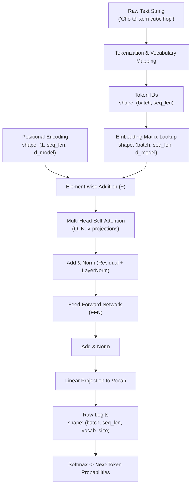

# Nền Tảng Kiến Trúc Transformer (Transformer Foundation)

Tài liệu này tổng hợp toàn bộ lý thuyết nền tảng, cơ chế tính toán tensor và trực giác hình học của kiến trúc **Transformer**. Nội dung được biên soạn làm cầu nối kỹ thuật giữa các mô hình học sâu truyền thống (Month 02) và kỹ thuật ứng dụng mô hình ngôn ngữ lớn (LLM Engineering - Month 03) trong dự án `ai-assistant-platform`.

---

## 1. Bức Tranh Tổng Thể & Động Lực Phát Triển

### 1.1. Hạn chế của các phương pháp trước Transformer
Trong Tuần 1 đến Tuần 3, hệ thống đã thử nghiệm hai cách tiếp cận:
1. **Đặc trưng thủ công (Hand-crafted Features - Scikit-learn Baseline)**:
   - Dùng độ dài câu (`text_length`), số từ (`word_count`), cờ chứa dấu `?`.
   - **Hạn chế**: Bỏ qua hoàn toàn trật tự từ và ngữ nghĩa từ vựng. Hai câu khác hẳn ý định như *"Lên lịch họp"* và *"Soạn email gấp"* có thể có vector đặc trưng y hệt nhau.
2. **Mạng nơ-ron truyền thống (MLP / RNN / LSTM)**:
   - **MLP**: Phẳng hóa hoặc gom trung bình từ làm mất ngữ cảnh chuỗi (loss of sequence order).
   - **RNN / LSTM**: Xử lý tuần tự từ trái qua phải từng token một. Quá trình này không thể tính toán song song (parallelization bottleneck) và dễ gặp hiện tượng suy hao thông tin khi câu quá dài (vanishing context over long range).

### 1.2. Đột phá của Transformer
Kiến trúc Transformer (Vaswani et al., 2017) giải quyết triệt để hai bài toán trên nhờ:
- **Cơ chế Tự chú ý (Self-Attention)**: Cho phép mọi từ trong câu tương tác trực tiếp với nhau theo thời gian hằng số O(1) về khoảng cách thông tin.
- **Tính toán song song hoàn toàn (Full Parallelization)**: Không cần vòng lặp qua từng bước thời gian như RNN, toàn bộ câu được xử lý đồng thời dưới dạng các ma trận tensor trên GPU.



---

## 2. Tokenization, Vocabulary & Attention Mask

Giai đoạn đầu tiên của mọi hệ thống Transformer là chuyển đổi văn bản dạng chuỗi ký tự tự nhiên thành các số nguyên (Token IDs) mà mô hình số học có thể xử lý.

Chi tiết cài đặt minh họa tại script: [tokenization_overview.py](file:///e:/repos/cilel1/ai-assistant-platform/scripts/tokenization_overview.py).

### 2.1. Phân biệt các khái niệm cốt lõi
- **Raw Text**: Chuỗi ký tự thô do người dùng nhập (ví dụ: `"Tôi muốn biết lịch trình hôm nay"`).
- **Token**: Đơn vị ngôn ngữ nhỏ nhất sau khi cắt chuỗi (có thể là từ, từ con - subword, hoặc ký tự).
- **Vocabulary (Từ vựng)**: Bảng tra cứu ánh xạ hai chiều giữa token (chuỗi) và số nguyên duy nhất (Token ID).
- **Special Tokens**:
  - `<pad>` (thường có ID = `0`): Dùng để bù độ dài cho các câu ngắn hơn trong cùng một batch.
  - `<unk>` (thường có ID = `1`): Đại diện cho các từ chưa từng xuất hiện trong từ vựng (Out-of-Vocabulary - OOV).

### 2.2. Vai trò sống còn của Attention Mask
Khi nhóm các câu có độ dài khác nhau vào chung một tensor 2D `(batch_size, max_seq_length)`, các vị trí thiếu sẽ được điền bằng `pad_id = 0`.

Tuy nhiên, `<pad>` chỉ là một giá trị lấp chỗ trống kỹ thuật số, **không mang thông tin ngữ nghĩa**. Nếu đưa trực tiếp vào phép toán Self-Attention, mô hình sẽ bị phân tán sự chú ý vào các token vô nghĩa này.

Do đó, hệ thống cần tạo một ma trận nhị phân **Attention Mask**:
- Giá trị `1`: Token thực tế cần được tính toán sự chú ý.
- Giá trị `0`: Vị trí padding cần bị vô hiệu hóa (triệt tiêu trọng số attention về `0` qua phép gán `-inf` trước khi vào Softmax).

```text
Sequence A (9 tokens): [3, 15, 16, 5, 4, 7, 12, 14, 11] -> Mask: [1, 1, 1, 1, 1, 1, 1, 1, 1]
Sequence B (7 tokens): [15, 9, 2, 8, 13, 6, 10, 0, 0] -> Mask: [1, 1, 1, 1, 1, 1, 1, 0, 0]
                                                   ▲   ▲                    ▲   ▲
                                                Padding Tokens           Mask = 0
```

> [!NOTE]
> Script [tokenization_overview.py](file:///e:/repos/cilel1/ai-assistant-platform/scripts/tokenization_overview.py) sử dụng phương pháp tách từ theo khoảng trắng (whitespace tokenization) nhằm mục đích giáo khoa. Trong các LLM sản xuất thực tế (GPT-4, LLaMA), các thuật toán subword tinh vi hơn như **Byte-Pair Encoding (BPE)** hoặc **WordPiece** được sử dụng để tránh hiện tượng bùng nổ kích thước từ vựng và xử lý linh hoạt mọi từ ghép, tiền tố, hậu tố.

---

## 3. Embedding Lookup & Kích Thước Tensor (Tensor Shapes)

Token ID chỉ là các chỉ số định danh rời rạc (categorical integers). Một số nguyên lớn hơn không có nghĩa là từ đó có giá trị lớn hơn hay quan trọng hơn.

### 3.1. Bảng Embedding (`torch.nn.Embedding`)
Để đưa vào mạng nơ-ron, mỗi token ID được ánh xạ thành một vector thực nhiều chiều (dense vector) thông qua bảng embedding:
- Bảng embedding thực chất là ma trận trọng số có kích thước `W_embed ∈ ℝ^(vocab_size × embedding_dim)`.
- Khi truyền vào một token ID `k`, thao tác lookup tương đương với việc lấy ra dòng thứ `k` của ma trận: `v = W_embed[k, :]`.
- **Quan trọng**: Các vector này là tham số có thể huấn luyện (learnable parameters). Qua quá trình huấn luyện, các từ có ngữ nghĩa hoặc ngữ cảnh tương đồng sẽ tự động hội tụ về gần nhau trong không gian vector.

### 3.2. Biến đổi kích thước Tensor (Shape Transformation)
1. **Đầu vào (Input IDs)**:
   - Kích thước: `(batch_size, sequence_length)`
   - Kiểu dữ liệu: `torch.long`
2. **Sau khi Embedding Lookup**:
   - Kích thước: `(batch_size, sequence_length, embedding_dim)`
   - Kiểu dữ liệu: `torch.float32`

---

## 4. Cơ Chế Scaled Dot-Product Attention

Đây là trái tim của kiến trúc Transformer, cho phép từng token trong chuỗi "nhìn" sang các token khác để cập nhật biểu diễn ngữ cảnh cho chính nó.

```mermaid
flowchart LR
    Q["Query (Q)<br/>(seq_len, d_k)"] --> M1["MatMul (Q · Kᵀ)"]
    K["Key (K)<br/>(seq_len, d_k)"] --> M1
    M1 --> S["Scale by 1/√d_k"]
    S --> MS["Optional Masking<br/>(Padding / Causal)"]
    MS --> SM["Softmax (dim=-1)"]
    SM -->|Attention Weights (seq_len, seq_len)| M2["MatMul (Weights · V)"]
    V["Value (V)<br/>(seq_len, d_v)"] --> M2
    M2 --> O["Output Context Vectors<br/>(seq_len, d_v)"]
```

### 4.1. Bộ ba Query (Q), Key (K), Value (V)
Từ vector embedding ban đầu của mỗi token, mô hình chiếu qua ba ma trận trọng số học được để tạo thành 3 vector:
- **Query (Q)**: Vector đại diện cho câu hỏi: *"Tôi là token hiện tại, tôi đang cần tìm kiếm thông tin gì xung quanh?"*
- **Key (K)**: Vector đại diện cho nhãn/chỉ mục: *"Tôi có đặc điểm gì để các token khác tìm đến tôi?"*
- **Value (V)**: Vector đại diện cho nội dung thực: *"Nếu bạn chú ý đến tôi, đây là lượng thông tin tôi sẽ cung cấp cho bạn."*

### 4.2. Công thức toán học & Các bước tính toán

`Attention(Q, K, V) = softmax((Q · Kᵀ) / √d_k) · V`

1. **Tính điểm thô (Raw Attention Scores)**: `Scores = Q · Kᵀ`
   - Thực hiện nhân ma trận giữa Q và K chuyển vị.
   - Kích thước: `(batch, seq_len, d_k) × (batch, d_k, seq_len) -> (batch, seq_len, seq_len)`.
   - Mỗi phần tử `Scores[i, j]` thể hiện độ tương thích giữa token thứ `i` và token thứ `j`.

2. **Chia tỷ lệ (Scaling)**: `Scores_scaled = Scores / √d_k`
   - Khi chiều không gian `d_k` lớn, tích vô hướng `Q · Kᵀ` có phương sai xấp xỉ bằng `d_k`.
   - Nếu không chia cho `√d_k`, các giá trị điểm số sẽ quá lớn, khiến hàm `softmax` bị đẩy vào vùng cực trị (bão hòa), làm đạo hàm (gradients) triệt tiêu về 0, cản trở việc cập nhật trọng số.

3. **Áp dụng Mask (Masking)**:
   - Với các vị trí padding hoặc token tương lai (trong decoder), gán giá trị tại đó bằng `-∞` (`-inf`).
   - Khi đi qua `softmax`, `e^(-∞) = 0`, đảm bảo trọng số chú ý tại các vị trí đó hoàn toàn bằng 0.

4. **Chuẩn hóa xác suất (Softmax)**: `Weights = softmax(Scores_scaled, dim=-1)`
   - Tổng trọng số của từng dòng bằng 1.0. `Weights[i, j]` là mức độ token `i` chú ý vào token `j`.

5. **Tổng hợp thông tin (Weighted Sum)**: `Output = Weights · V`
   - Kích thước: `(batch, seq_len, seq_len) × (batch, seq_len, d_v) -> (batch, seq_len, d_v)`.
   - Mỗi token nhận được một vector ngữ cảnh mới, là trung bình có trọng số của toàn bộ các vector Value trong câu.

---

## 5. Multi-Head Attention & Positional Encoding

### 5.1. Multi-Head Attention (Chú ý Đa đầu)
Thay vì chỉ tính toán một không gian attention duy nhất với chiều `d_model`, mô hình chia nhỏ `d_model` thành `h` "đầu" (heads) độc lập:
- `head_dim = d_model / h` (điều kiện bắt buộc: `d_model` phải chia hết cho `h`).
- **Lợi ích**: Từng head có thể chuyên môn hóa học các mối quan hệ khác nhau trong câu:
  - Head 1: Chuyên theo dõi mối quan hệ cú pháp (Chủ ngữ - Động từ).
  - Head 2: Chuyên theo dõi từ bổ nghĩa thời gian/địa điểm (ví dụ: liên kết `"họp"` với `"tuần này"`).
  - Head 3: Chuyên giải quyết đại từ thay thế (ví dụ: liên kết `"nó"` với danh từ trước đó).
- **Quy trình kết hợp**: Đầu ra của tất cả các head được ghép nối lại (concatenation) rồi nhân qua một ma trận chiếu tuyến tính `W_O` để đưa về kích thước gốc `(batch, seq_len, d_model)`.

### 5.2. Positional Encoding (Mã hóa Vị trí)
- **Vấn đề**: Phép tính Self-Attention hoàn toàn độc lập với thứ tự (permutation invariant). Nếu hoán đổi vị trí của các từ trong câu:
  - Câu 1: *"Tôi bận buổi sáng, rảnh buổi chiều"*
  - Câu 2: *"Tôi rảnh buổi sáng, bận buổi chiều"*
  Nếu không có thông tin vị trí, các tích vô hướng trong attention sẽ cho kết quả giống nhau, khiến mô hình hiểu sai hoàn toàn ngữ nghĩa.
- **Giải pháp**: Tạo ra một vector vị trí cùng kích thước `(seq_len, d_model)` và **cộng trực tiếp** vào vector embedding của từ:
  `x_input = Embedding(token) + Positional_Encoding(position)`
- Phương pháp mã hóa vị trí có thể là:
  - Sinusoidal (hàm lượng giác cố định theo tần số - đề xuất trong paper gốc).
  - Learned Positional Embedding (tham số học được như trong BERT, GPT-2).
  - Rotary Position Embedding (RoPE - tiêu chuẩn vàng trong các LLM hiện đại như LLaMA, Mistral).

---

## 6. Phân Biệt Các Họ Kiến Trúc Transformer

Dựa trên cách kết hợp khối Encoder và Decoder cùng cơ chế che mặt nạ (Masking), các mô hình Transformer được chia thành 3 họ kiến trúc chính:

| Tiêu chí | Encoder-only | Decoder-only | Encoder-Decoder |
| :--- | :--- | :--- | :--- |
| **Cơ chế Attention** | Hai chiều (Bidirectional) - Token nhìn được cả trước và sau. | Đơn chiều (Causal / Autoregressive) - Chỉ nhìn về quá khứ và chính nó. | Encoder: Hai chiều.<br/>Decoder: Causal + Cross-attention sang Encoder. |
| **Mặt nạ Causal Mask** | Không sử dụng. | Bắt buộc (tam giác trên gán `-inf`). | Có trong nhánh Decoder. |
| **Mô hình tiêu biểu** | BERT, RoBERTa, DeBERTa, ELECTRA. | GPT-3/4, LLaMA, Mistral, Gemma, Claude. | T5, BART, mBART. |
| **Thế mạnh bài toán** | Trích xuất đặc trưng câu, Phân loại ý định (Intent), Nhận dạng thực thể (NER), Semantic Search. | Sinh văn bản tự nhiên, Đàm thoại (Chatbot), Lập trình mã nguồn, Tiếp nối câu (Text Completion). | Dịch máy (Machine Translation), Tóm tắt văn bản dài (Summarization), Audio-to-Text. |
| **Đầu ra mục tiêu** | Representation vector hoặc nhãn phân loại tĩnh. | Chuỗi token kế tiếp được sinh lặp lại (Next-token generation). | Chuỗi token mục tiêu (Target sequence) độc lập với nguồn. |

### 6.1. Chi tiết cơ chế Next-Token Prediction trong Decoder-only LLM
Các mô hình AI tạo sinh hiện đại hoạt động dựa trên nguyên lý dự đoán token tiếp theo:
1. Nhận prompt người dùng: `"Lên lịch họp vào thứ"`
2. Đưa qua các tầng Causal Self-Attention (token `"thứ"` chỉ được nhìn thấy `"Lên"`, `"lịch"`, `"họp"`, `"vào"`, `"thứ"`).
3. Tầng Linear cuối cùng ánh xạ vector đầu ra về kích thước từ vựng `(vocab_size)`.
4. Tính xác suất Softmax và chọn ra token kế tiếp có xác suất cao nhất: `"Sáu"`.
5. Nối `"Sáu"` vào prompt cũ thành: `"Lên lịch họp vào thứ Sáu"` và lặp lại chu trình cho đến khi gặp token kết thúc chuỗi `<eos>` (End-of-Sequence).

---

## 7. Liên Hệ Với Dự Án `ai-assistant-platform` & Chuyển Giao Tháng 03

### 7.1. Nhìn lại hành trình tiến hóa tại Month 02
1. **Tuần 1 & 2 (Data Pipeline & Scikit-learn Baseline)**:
   - Xây dựng pipeline chuẩn mực, hạn chế data leakage.
   - Thử nghiệm với heuristic features cho thấy giới hạn của mô hình truyền thống khi không hiểu ngữ cảnh từ.
2. **Tuần 3 (PyTorch MLP Intent Classifier)**:
   - Làm chủ chu trình huấn luyện sâu (Dataset, DataLoader, Loss, Optimizer, Backpropagation).
   - Thiết lập mô hình nơ-ron phân loại đa lớp có độ ổn định số học cao.
3. **Tuần 4 (Transformer Foundation)**:
   - Hiểu rõ cơ chế biểu diễn vector học được (learned dense embeddings) và sự tương tác ngữ cảnh qua cơ chế Self-Attention.
   - Nắm vững các kích thước tensor cốt lõi phục vụ gỡ lỗi và hiểu sâu cấu trúc mô hình.

### 7.2. Định hướng Month 03: LLM Engineering trong Thực Tế
Trong các hệ sinh thái sản xuất (Production Systems), chúng ta **không tự huấn luyện lại một mô hình Transformer từ đầu** (vốn đòi hỏi chi phí hàng triệu USD và hàng ngàn GPU). Thay vào đó, toàn bộ kiến thức nền tảng trong tài liệu này sẽ phục vụ trực tiếp cho:
- **Kiểm soát Context Window & Tokenization**: Hiểu rõ cách đếm token, chi phí inference theo token, và cách ngắt chuỗi an toàn.
- **Tích hợp LLM APIs & Structured Outputs**: Khai thác các mô hình Decoder-only hàng đầu (Gemini, GPT) kết hợp Pydantic để tạo Function Calling / Tool Calling cho Assistant Platform.
- **Xây dựng RAG (Retrieval-Augmented Generation)**: Ứng dụng mô hình Encoder-only (như text-embedding-3-small) để sinh dense vector index, phục vụ tra cứu tài liệu ngữ nghĩa trước khi đưa vào context của LLM.

---

## 8. Tài Liệu Tham Khảo Kỹ Thuật (Official References)

1. **Hugging Face Course**:
   - [How do Transformers work?](https://huggingface.co/docs/course/main/en/chapter1/4) - Phân tích chi tiết attention layer và khối encoder/decoder.
   - [Transformer Architectures](https://huggingface.co/docs/course/chapter1/6) - So sánh 3 họ kiến trúc Encoder, Decoder, Sequence-to-Sequence.
   - [Hugging Face Transformers Glossary](https://huggingface.co/docs/transformers/main/glossary) - Tra cứu thuật ngữ attention mask, causal mask, token embeddings.
2. **Minh họa trực quan kinh điển**:
   - [The Illustrated Transformer - Jay Alammar](https://jalammar.github.io/illustrated-transformer/) - Hướng dẫn trực quan chi tiết từng bước tính toán ma trận trong Self-Attention và Multi-Head Attention.
3. **Tài liệu PyTorch chính thức**:
   - [PyTorch torch.nn.Transformer Documentation](https://docs.pytorch.org/docs/stable/generated/torch.nn.modules.transformer.Transformer.html) - Đặc tả kỹ thuật về tensor shapes và tham số mô hình.
4. **Bài báo nền tảng gốc**:
   - Vaswani et al. (2017): [Attention Is All You Need](https://arxiv.org/abs/1706.03762).
